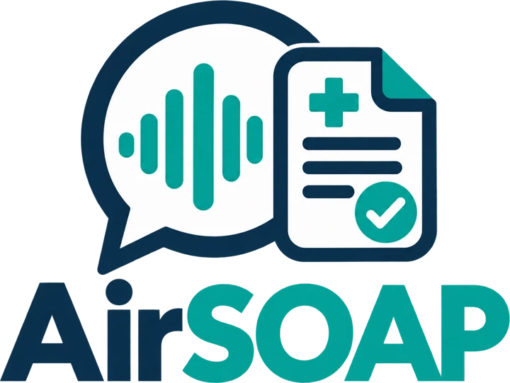

<p align="center">
  
</p>

# AirSOAP

A local-first clinical documentation assistant. It listens to a visit, writes down what was said, and helps a clinician turn it into a reviewed **SOAP note** (Subjective, Objective, Assessment, Plan). Recording, transcription and note drafting all run on one small computer in the room, a Raspberry Pi 5, and nothing is sent to the cloud.

> **This is a prototype.** It is built and tested with fictional patients only. It makes no claim of regulatory compliance or production readiness, it connects to no electronic medical record (EMR), and a clinician must review everything it produces.

## Contents

- [What it does](#what-it-does)
- [Features](#features)
- [How it works](#how-it-works)
- [Privacy and security](#privacy-and-security)
- [Repository layout](#repository-layout)
- [Run it on a Mac](#run-it-on-a-mac)
- [Deploy it on a Raspberry Pi](#deploy-it-on-a-raspberry-pi)
- [Known limitations](#known-limitations)
- [Possible future improvements](#possible-future-improvements)
- [Where to read more](#where-to-read-more)

## What it does

A visit with AirSOAP goes like this:

1. **Sign in** with your own account.
2. **Identify the patient** (name, date of birth, visit type). Only the age and visit type are ever shared with the AI.
3. **Record the visit** with the Pi's USB microphone, after confirming the patient consented. The transcript appears on screen a few seconds after each pause.
4. **Review the transcript.** Correct any words and mark who spoke each turn, by hand or with AI suggestions.
5. **Draft the SOAP note.** A local language model writes it from the labelled transcript, using only what was said.
6. **Edit and, optionally, run a clinical review** that points out information gaps (with a question you could ask) and places where the note differs from what was said. It never changes the note.
7. **Submit.** In this prototype nothing is sent anywhere: the encounter is cleared from memory.

## Features

### Recording and transcription
- **Microphone recording on the Pi** through ALSA's `arecord`, under the backend's control.
- **Live transcript while recording.** The speech is cut at pauses and each stretch is transcribed once by a fast Whisper model (`base.en`). That live transcript is the final transcript, so there is no long wait after Stop.
- **Honest status.** The live panel says whether it is listening, working, running behind, has stopped, or is reconnecting. It never claims to be live when it is not.
- **Automatic fallback.** If live transcription fails, the recording continues and the whole file is transcribed with the more accurate `small.en` model when you stop. Nothing is lost.
- **One model in memory at a time.** The Pi has 4 GB of RAM, so speech models and the language model take turns.

### AI assistance (all local, through Ollama)
- **SOAP note draft** from the labelled transcript, with these safeguards:
  - it may only state a diagnosis or plan that the clinician said out loud, otherwise it writes "Not documented.";
  - numbers in the note that are not in the transcript are flagged;
  - a diagnosis-like assessment with no matching clinician statement is flagged.
- **Clinical review** (on request): suggestions only, each backed by a quote that the server checks really appears in the transcript or note. Unverified suggestions are dropped.
- **Speaker suggestions** (on request): labels each turn Clinician, Patient or Unknown from the words alone. They are marked **AI** until the clinician accepts them, never replace a label the clinician set, and anything uncertain stays Unknown.
- **Validated output.** Every answer must match a strict schema; unusable answers are retried once and then reported, never shown.

### Accounts and security
- **Individual accounts.** An administrator creates, edits, disables and resets accounts; there is no self-registration and no default account.
- **Two roles**, enforced on the server: **clinician** (encounters and notes) and **administrator** (accounts only). An account with both roles chooses one at each sign-in.
- **Sign-in protection:** Argon2id password hashing, generic error messages, rate limiting, temporary passwords that must be changed at first sign-in, and sessions that end after 30 idle minutes or 12 hours.
- **Cross-site request protection**, strict security headers, and an audit trail of account events that never contains passwords, tokens or clinical content.
- **HTTPS on the local network** through Caddy, on one address for the app and the API.
- **Everything a clinician has open is discarded** when their session ends: the browser drops the encounter, and the backend cancels their recording and jobs and deletes the audio.

### Interface
- A clinical workspace, an administrator's account screen, and a sign-in page, in one consistent design.
- A step-by-step encounter flow with a progress bar, a live transcript panel, a review screen with a sticky checklist, and quick speaker-labelling tools.
- A live preview of exactly what the AI will and will not see as the patient's details are typed.
- Works on phones, tablets and desktops, with keyboard and screen-reader support, and respects "reduce motion".
- A fully simulated **demo mode** (no backend needed) for trying the interface.

## How it works

```
browser ──HTTPS──▶ Caddy :443 (raspberrypi.local, local certificate authority)
                      │
                      └──▶ FastAPI 127.0.0.1:8000 ── serves the web app and /api
                                 │                    checks the session and role on every request
                                 │                    account database (SQLite, on the SD card)
                                 │
                                 ├─ arecord ──▶ temporary WAV in a RAM-backed folder
                                 │
                                 ├─ live worker ─▶ whisper-server (base.en)   127.0.0.1:8179   while recording
                                 ├─ fallback ────▶ whisper-server (small.en)  127.0.0.1:8178   whole file, only if needed
                                 │
                                 └─ AI tasks ────▶ Ollama (Qwen 2.5 3B)       127.0.0.1:11434   SOAP, review, speakers
```

Key design decisions:

- **Local first.** Audio never leaves the device. The backend refuses non-loopback addresses for Whisper and Ollama.
- **One heavy job at a time.** A shared gate makes recording, transcription and each AI task take turns and unloads the model that is not needed, which is what lets a 4 GB Pi run all of this.
- **Clinical content is never stored.** The only database holds accounts, session hashes and an audit trail. Transcripts, notes and reviews live in memory only and are dropped at sign-out, after a timeout, or when the encounter ends.
- **The clinician stays in control.** Every AI output is a suggestion: speaker labels are marked until accepted, the note is editable, the review never edits the note, and a late AI answer can never overwrite the clinician's edits.
- **Measured, not assumed.** The live-transcription design was chosen from benchmarks run on the actual Pi (`backend/scripts/bench_live.py`): a sliding window fell behind, reduced audio context made Whisper invent text, and the `small.en` model could not keep up live. Pause-cut blocks with `base.en` could.

### Technology

| Part | What it uses |
| --- | --- |
| Frontend | React 19, TypeScript, Vite, Tailwind CSS v4, Vitest, oxlint |
| Backend | Python 3.13, FastAPI, SQLite, Argon2id (`argon2-cffi`) |
| Speech to text | whisper.cpp `whisper-server` with `base.en` (live) and `small.en` (fallback) |
| Language model | Ollama running Qwen 2.5 3B (note, review, speakers) |
| Serving | Caddy (HTTPS with a local certificate authority), systemd user service |
| Hardware | Raspberry Pi 5 (4 GB), USB microphone |

## Privacy and security

- All audio capture, transcription and AI processing run on the device. There are no cloud APIs, analytics or telemetry.
- The AI never receives the patient's name, date of birth or MRN: the browser removes them from the transcript and note before any request, and sends only age (`90+` for 90 and over) and visit type.
- Audio is deleted as soon as its transcription finishes, fails or is cancelled, and leftovers from a crash are swept at startup.
- Logs contain IDs, durations and timings only, never transcript text, notes, prompts, passwords or session values. Tests check this.
- The browser keeps nothing: no local storage, no cookies it can read, and the session cookie is `HttpOnly`, `Secure` and `SameSite=Strict`.
- Ollama and whisper-server listen on loopback only. Only SSH and Caddy are reachable from the network.

These are engineering safeguards, not a compliance claim. See [Known limitations](#known-limitations).

## Repository layout

```
AirSOAP/
├─ backend/                 FastAPI service, accounts, live transcription, AI tasks
│  ├─ airsoap/              the application (auth/, db/, live/, ai/, transcription/, recording/, api/)
│  ├─ tests/                backend tests (no microphone, Whisper or Ollama needed)
│  ├─ scripts/              smoke tests, the Pi benchmark, configuration check
│  ├─ deploy/               systemd unit, Caddyfile, env example, Ollama settings
│  └─ README.md             operator guide: setup, deployment, accounts, recovery
└─ frontend/                React web app
   ├─ src/                  screens, components, API clients (HTTP and demo), workflow
   └─ README.md             frontend notes
```

## Run it on a Mac

You do not need a microphone, Whisper or Ollama: the Mac uses a mock recorder, a simulated live transcript and a mock AI.

```bash
# Backend
cd backend
python3 -m venv .venv
.venv/bin/pip install -r requirements-dev.txt
.venv/bin/python -m pytest                                   # the whole backend test suite
.venv/bin/python -m airsoap.admin --no-env-file create-admin \
    --email dev@example.test --name "Dev Admin" --also-clinician   # asks for a password
.venv/bin/python -m airsoap                                  # http://127.0.0.1:8000

# Frontend (second terminal)
cd frontend
npm install
VITE_AIRSOAP_API=http npm run dev                            # http://localhost:5173, uses the backend
npm test && npm run lint && npm run typecheck
```

Without `VITE_AIRSOAP_API=http` the frontend runs its built-in demo, where any email and password sign in. The tests never touch a real account database.

## Deploy it on a Raspberry Pi

The full, step-by-step guide is in [`backend/README.md`](backend/README.md). In short:

1. Install whisper.cpp (with the `small.en` and `base.en` models), Ollama (with `qwen2.5:3b-instruct`) and Caddy.
2. Create the Python environment, build the frontend (`VITE_AIRSOAP_API=http npm run build`) and copy `backend/deploy/airsoap.env.example` to `~/.config/airsoap/airsoap.env`.
3. Install the systemd user service and the Caddyfile.
4. Create the first administrator with `python -m airsoap.admin create-admin`.
5. Trust Caddy's certificate on each device and open `https://raspberrypi.local`.
6. Run `bash scripts/check_config.sh` to verify the setup.

## Known limitations

- **Not for real patients.** It is a prototype, built and tested with fictional data. It has had no clinical validation and no security audit, and it makes no regulatory claims.
- **The AI can be wrong.** A small local model can misword or miss things. The safeguards reduce the risk and do not remove it, and a clinician must review every section.
- **Live text is less accurate than a whole-file pass.** The live model scored 8% word errors on a test consultation against 6% for the larger one, and it is weaker on medical words and numbers.
- **Speakers are not recognised by voice.** Whisper cannot tell voices apart. Suggestions come from the words alone and can be wrong or Unknown.
- **Turns follow pauses, not speakers.** If two people talk without a pause, they can end up in one turn.
- **No EMR connection.** Submission is a local demonstration.
- **English only** (the `.en` models).
- **One recording and one AI task at a time**, because of the Pi's memory and CPU.
- **Sign-in is email and password only**, with no second factor and no self-service reset. Devices must trust the local certificate by hand, and the SD card is not encrypted.
- **Heat.** Continuous transcription runs the Pi at 75–83 °C even with active cooling.

## Possible future improvements

**Transcription and speakers**
- Voice-based **speaker diarization**, so turns are separated by who is speaking instead of by pauses (a separate model and a separate feature).
- Splitting a turn into two in the review screen.
- Streaming Whisper with word-level timestamps, and a medical vocabulary or custom dictionary for drug names and numbers.
- Other languages, and automatic language detection.
- Benchmarking a faster or quantized `small.en`, or a newer small model, to bring live accuracy closer to whole-file accuracy.

**Hardware acceleration**
- **An AI accelerator add-on for the Pi** (a Raspberry Pi AI HAT or similar). Today everything runs on the Pi's CPU, which is why a visit has to be transcribed in pause-cut blocks, why the 3B model takes a minute or more per task, and why the Pi runs hot. An accelerator could run speech and language models faster and with less heat, which would allow a larger or more accurate model, live transcription with the `small.en` model, and speaker suggestions during the visit. Caveats: these boards are neural accelerators (NPUs), not general GPUs, and the common Whisper and Ollama builds used here run on the CPU, so the models would need to be converted to the accelerator's own format and runtime. Support for language models differs between boards, so check the current board and software before buying.
- **A device with a real GPU**, such as an NVIDIA Jetson, a small mini-PC with a graphics card, or a Mac mini (Apple silicon). The same backend would run there with a larger model and much shorter waits. The benchmark script (`backend/scripts/bench_live.py`) can measure any candidate device in the same way it measured the Pi.
- **More memory.** A Pi 5 with 8 GB of RAM could keep the live model and the note model loaded together and avoid the 30 s model switches.
- **Better cooling and an enclosure**, since sustained transcription already brings the Pi close to its throttling temperature.

**Model quality and fine-tuning**
- **Fine-tuning the language model for clinical notes.** A model adapted to SOAP notes (for example with LoRA, trained on a workstation and then converted for the Pi) could follow the "only what was said" rules more reliably, word notes the way a clinic prefers, and label speakers better.
- **Fine-tuning Whisper on medical speech**, to reduce errors on drug names, anatomy and numbers.
- **Training data has to be handled with care.** Fine-tuning on real medical records needs consent, ethics or institutional approval, and thorough de-identification, and must not happen on the clinic's device or with patient data from this app, which deliberately stores none. Safer starting points are synthetic consultations and published research datasets for clinical dialogue and note generation, each used under its own licence and access terms.
- **Measure before and after.** Any new or fine-tuned model should be scored on a fixed set of fictional consultations (accuracy, invented content, "Not documented" behaviour) before it replaces the current one.

**AI quality**
- Evaluating the SOAP and clinical-review prompts against a larger set of fictional consultations, with scoring in CI.
- Benchmarking the 3B model's speaker suggestions on the Pi, and trying a larger model on faster hardware.
- Note templates by specialty and visit type, and a patient-friendly summary.
- Structured codes (for example ICD-10 or SNOMED suggestions), always as suggestions.

**Integration**
- Export in a standard format (FHIR) or a connection to an EMR, with a careful design for consent, audit and data handling.
- Optional encrypted, clinician-controlled saving of finished notes, which today are deliberately never stored.
- Printing and PDF export of the final note.

**Security and operations**
- A second factor for sign-in, self-service password reset, and sign-in from a hardware key.
- Encrypting the SD card or the account database at rest, and a tamper-evident audit log.
- A signed update path, automatic backups of the account database, and a health dashboard for the device (temperature, memory, model status).
- A formal security review and a threat model before any use beyond fictional data.

**Device and deployment**
- A pre-built Pi image and an installer script.
- Better microphones and noise handling, and a Pi 5 with 8 GB of RAM so that more than one model can stay loaded.
- Running on other hardware, such as a small mini-PC or a Mac mini, with the same code.

**Interface**
- Keyboard shortcuts for labelling speakers, a transcript search, and an audio-free "highlight what changed" view between the live and edited text.
- Per-clinician preferences, and administrator reports with no patient data.
- Translations of the interface.

## Where to read more

- [`backend/README.md`](backend/README.md): the API, configuration, accounts and sign-in, live transcription, the Pi deployment, backups, recovery, and troubleshooting.
- [`frontend/README.md`](frontend/README.md): the structure of the web app, the workflow, and how the interface handles sessions and privacy.
- [`backend/scripts/bench_live.py`](backend/scripts/bench_live.py): the benchmark behind the live-transcription design.
